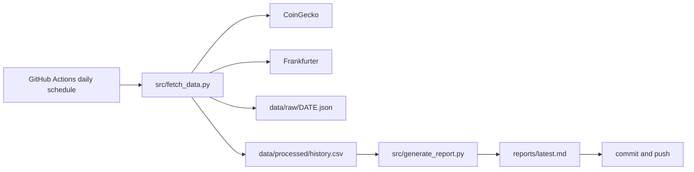

# Daily FinTech Signal Tracker (log_it)

A small Python job that records the BTC/USD, ETH/USD and GBP/USD prices once a day, keeps the history in a CSV and writes a short markdown summary. GitHub Actions runs it and commits the results. It is a portfolio piece for anyone looking at scheduled data collection with plain tools.

See [FAILURES.md](FAILURES.md) for what can go wrong, what broke and how it was handled.

## What it does

- Pulls BTC and ETH prices in USD, with their 24 hour change, from the CoinGecko public API.
- Pulls the GBP to USD rate from the Frankfurter API (European Central Bank reference rates).
- Saves the raw response for the day as `data/raw/YYYY-MM-DD.json`.
- Adds or replaces today's row in `data/processed/history.csv`, so running twice in one day does not create duplicates.
- Writes `reports/latest.md` with the snapshot, the day over day change and a one line interpretation.

## How it works



The workflow in `.github/workflows/daily.yml` is scheduled for 08:17 UTC and can also be started by hand from the Actions tab. GitHub often runs scheduled jobs late; recent runs started around 14:30 to 15:15 UTC.

## Quick start

Needs Python 3.11 or newer and internet access. No API keys are required.

```bash
python3 -m venv .venv
.venv/bin/pip install -r requirements.txt
.venv/bin/python src/fetch_data.py
.venv/bin/python src/generate_report.py
cat reports/latest.md
```

Running it locally changes the files under `data/` and `reports/`, the same way the scheduled job does.

## Real output

`reports/latest.md` as committed by the scheduled run on 1 November 2026:

```text
## Snapshot
- BTC/USD: 78009.00
- ETH/USD: 2270.84
- GBP/USD: 1.3399

## Day-over-day movement
- BTC/USD: +0.82%
- ETH/USD: +1.00%
- GBP/USD: +0.00%
```

The history file had 216 daily rows, from 25 March 2026 to 1 November 2026, when this README was written.

## Checks

Run on 1 November 2026 on Linux with Python 3.11, in a scratch copy so the committed data was not touched.

| Check | Result |
| --- | --- |
| Install from `requirements.txt` | ok |
| `fetch_data.py` then `generate_report.py` | ok, new row written and report regenerated |
| `ruff check src` | 2 style findings (import order, `datetime.UTC` alias), no errors in logic |
| Automated tests | none in the repo |
| Scheduled workflow | last three runs succeeded |

## Project structure

```text
src/fetch_data.py        calls both APIs, writes raw JSON and history.csv
src/generate_report.py   builds reports/latest.md from history.csv
src/utils.py             paths and JSON helpers
data/raw/                one JSON file per day
data/processed/          history.csv
reports/latest.md        latest summary
.github/workflows/       daily schedule
```

## Configuration

There is nothing to configure. The API URLs are constants at the top of `src/fetch_data.py`. The schedule is the `cron` line in the workflow.

## Limitations and known issues

- GBP/USD only changes on working days. The ECB does not publish rates at weekends or on its holidays, so those days repeat the previous rate and show +0.00%.
- There are no tests and no retry. If either API fails, the run fails and that day is missing until someone re-runs it.
- Each day overwrites the same row, so the stored price is whatever it was at the time the job happened to run, not a fixed closing price.
- The free CoinGecko endpoint is rate limited and has no service guarantee.
- The repo contains two `.achievements/pass-*.txt` files that are not used by the code.

## Status

Running. The daily job has been committing data since March 2026. It is a learning and portfolio project, not a trading tool, and nothing here is financial advice.

## Licence

MIT. See [LICENSE](LICENSE).

More of my work: https://cv.omnitest.dev/
